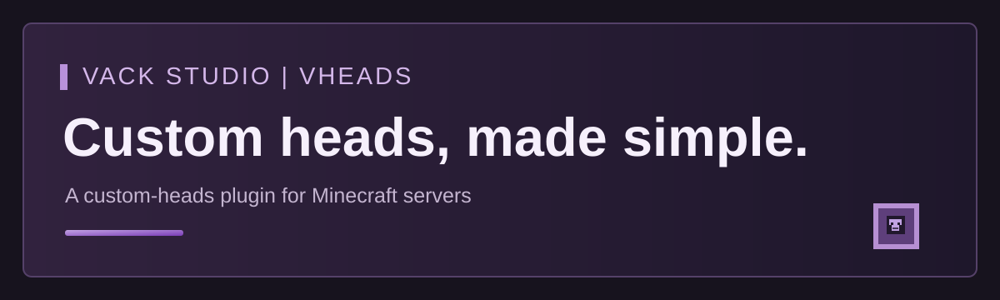

  

# VHeads | Vack Studio

VHeads is a Minecraft custom-heads plugin developed by Vack Studio.

## Availability

This public repository introduces VHeads. Source code and installable plugin files are shared privately by the project owner. No downloads are provided here.

## Credits and rights

Developed by Vack Studio.
Copyright (c) Vack Studio. All rights reserved.
