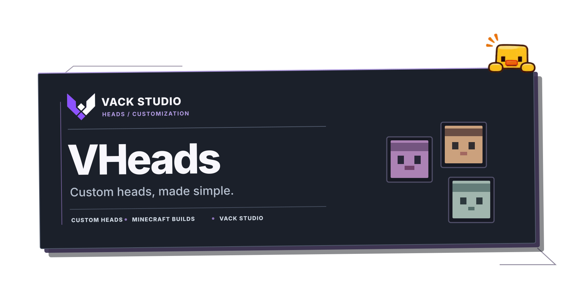
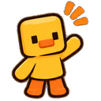
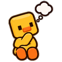
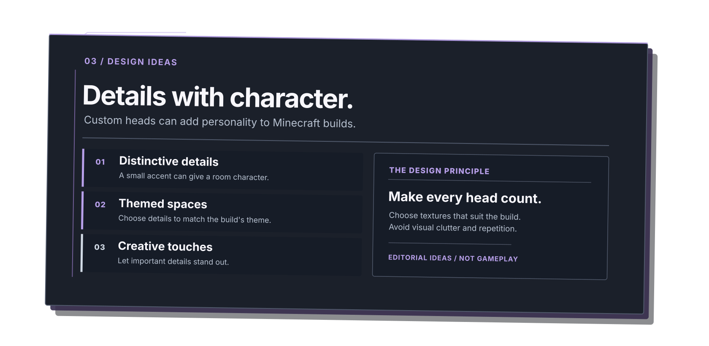
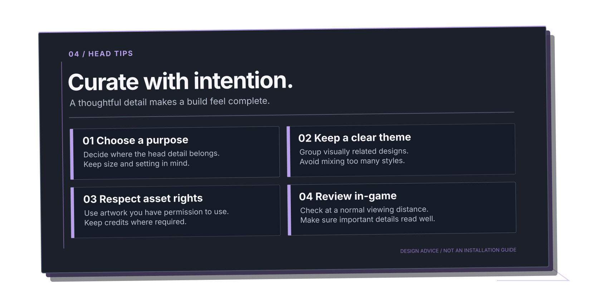
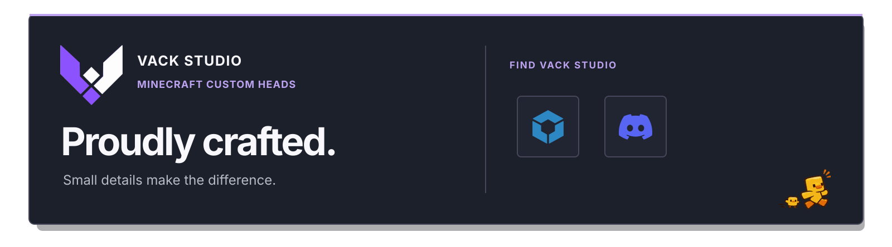

  

# VHeads 

**Custom heads, made simple.**

A few carefully chosen details can give a Minecraft build its identity. **VHeads** is a custom-heads plugin developed by **VACK STUDIO**, presented here as part of the studio's Minecraft project collection.

This showcase focuses on small decorative elements, considered presentation, and the creative possibilities of custom heads.

> [!IMPORTANT]
> **Commercial project showcase.** VHeads is proprietary software. This public repository introduces the project; it does not distribute source code, plugin JARs, or an installation guide. Features and compatibility beyond the public description have not been independently verified.

## Small details, big personality 

**A custom head is a small block with a lot of visual character.**

Minecraft heads can work as accents in builds and themed spaces. A distinctive face, carefully selected texture, or subtle decorative arrangement can help an environment feel personal.

The examples below are **design ideas**, not claims about a built-in VHeads catalog, interface, commands, or supported integrations.

  

| Design idea | Why it matters |
| :--- | :--- |
| **Distinctive details** | Give a room or display a recognizable visual accent |
| **Consistent themes** | Match head textures with the surrounding environment |
| **Thoughtful arrangements** | Let the decoration support the build rather than overwhelm it |

*This banner is an editorial illustration, not a screenshot from a running VHeads plugin.*

## Curate with intention 

  

A strong set of decorative heads starts with a purpose, not with collecting the largest possible number of textures.

- **Choose a purpose.** Know where and why a custom head belongs in your build.
- **Keep a visual theme.** Pick textures that fit the surrounding blocks, lighting, and scale.
- **Respect artwork rights.** Check permissions for textures or art you choose to reuse.
- **Review at Minecraft scale.** Test whether the detail is readable from a normal player viewpoint.

**Mini Zoiila's tip:** Start with a few strong details and expand only when they genuinely improve the space.

## Project information

| Item | Publicly documented status |
| --- | --- |
| Project | **VHeads** |
| Developer | **VACK STUDIO** |
| Category | Minecraft custom-heads plugin |
| Distribution | Proprietary; access is handled privately |
| Source code and plugin downloads | Not provided in this repository |
| Commands, supported versions, and dependencies | Not publicly verified |

Before deploying VHeads, ask the project owner for the tested build's supported server version, required dependencies, licensing terms, and setup documentation. This README intentionally avoids invented commands and compatibility claims.

## Access and licensing

**VHeads is a commercial VACK STUDIO project.** Contact the studio through its official channels for access, availability, and license information.

---

  

  
  &nbsp;&nbsp;&nbsp;&nbsp;
  

<strong>License &amp; artwork credits</strong>

Copyright © 2026 VACK STUDIO. All rights reserved.

VHeads and its presentation are proprietary to VACK STUDIO. Redistribution of software, artwork, and documentation requires appropriate authorization. Third-party components and assets retain their respective rights. 

The Mini Zoiila **Top Peek** pose in the first banner comes from the original V22 mascot artwork pack. Small Mini Zoiila emojis are reused from the Vgtb studio presentation to maintain a consistent VACK STUDIO style. The pixel-head drawings are editorial illustrations, not screenshots or a representation of verified in-game content.

